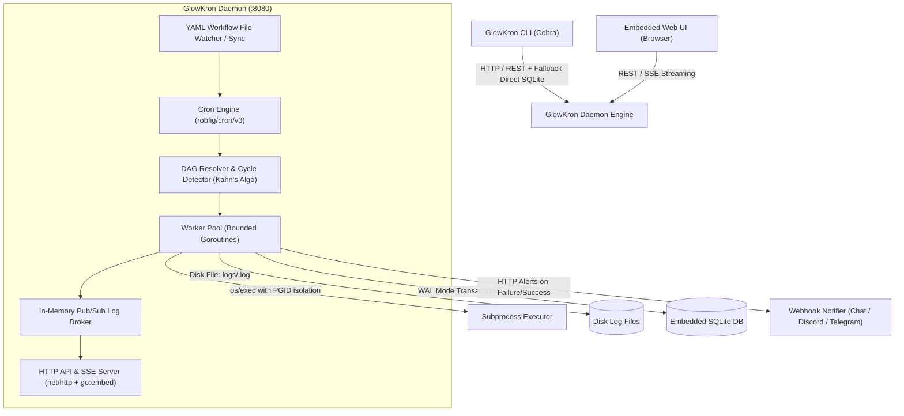

# GlowKron — Project Specification & Agent Roadmap

> **Target Spec:** `project-specs/glowkron-setup.md`  
> **Status:** APPROVED & ACTIVE  
> **Architecture Style:** Single-Binary, Zero-CGo, Pure Go Embedded Background Job & DAG Workflow Orchestrator  
> **Orchestration Team:** `agents-orchestrator`, `project-manager-senior`, `backend-architect`, `agency-frontend-developer`, `evidence-collector`, `reality-checker`  
> **Lead Architect / Human Gate:** George Santana

---

## 1. System Vision & Invariants

**GlowKron** is a single-binary background job and DAG workflow orchestrator written in Go. It automates personal developer tasks—backups, web scrapers, data pipelines, and maintenance scripts—with cron scheduling, multi-step dependency graphs (DAG), automatic retries with exponential backoff, real-time logging, embedded SQLite persistence, an embedded local web dashboard, and webhook alerts.

### Non-Negotiable Invariants
1. **Single-Binary Zero-Dependency Distribution:** Compiles into one self-contained Go executable (`glowkron`). Zero external runtime dependencies—no Redis, no Postgres, no Docker daemon, and **zero CGo** (uses `modernc.org/sqlite` pure Go).
2. **Subprocess Integrity & Process Group Isolation:** Subprocesses run via `os/exec.CommandContext` with `Setpgid: true`. On timeout or cancellation, the entire process group is terminated with `syscall.SIGKILL` to prevent orphaned zombie processes.
3. **Storage Durability & WAL Mode:** Embedded SQLite database (`~/.glowkron/glowkron.db`) initialized with Write-Ahead Logging (`PRAGMA journal_mode=WAL;`), foreign keys enabled, and transactional state updates.
4. **Hybrid Workflow Configuration:** Workflows are defined in declarative YAML files in a configured directory (e.g., `~/.glowkron/workflows/` or `./workflows/`) and auto-synced into SQLite upon daemon launch or reload, with ad-hoc workflow runs supported via CLI and Web UI.
5. **Real-time Logging & Storage Decoupling:** Live logs are streamed over an in-memory pub/sub broker to Server-Sent Events (SSE) and CLI followers. Full raw output is written to disk files (`~/.glowkron/logs/<run-id>.log`), while SQLite holds execution metadata, exit codes, and summary snippets (preventing DB bloat and lock contention).
6. **Unified Daemon API & Embedded Web Dashboard:** The daemon serves a lightweight REST API + SSE endpoint on `http://127.0.0.1:8080`. The Web UI is embedded directly into the Go binary using `//go:embed` with modern, clean vanilla JS / CSS (no external node_modules or CDN dependencies).
7. **Conventional Micro-Commits & TDD:** Every feature micro-step must ship with isolated Go unit tests (`_test.go`) and a conventional commit (`feat(...)`, `test(...)`, `refactor(...)`, `fix(...)`).

---

## 2. Architecture & Component Blueprint



---

## 3. Data Model (SQLite Schema)

All tables must be initialized with idempotent `CREATE TABLE IF NOT EXISTS` migrations.

```sql
-- Registered jobs / workflows
CREATE TABLE IF NOT EXISTS jobs (
    id TEXT PRIMARY KEY,
    name TEXT NOT NULL,
    description TEXT,
    cron_expr TEXT,                -- Standard cron expression or empty for ad-hoc
    max_retries INTEGER DEFAULT 0,
    retry_delay_sec INTEGER DEFAULT 10,
    timeout_sec INTEGER DEFAULT 3600,
    concurrency_group TEXT DEFAULT 'default',
    source_file TEXT,              -- Path to source YAML if file-based, NULL if ad-hoc
    enabled BOOLEAN DEFAULT 1,
    created_at DATETIME DEFAULT CURRENT_TIMESTAMP,
    updated_at DATETIME DEFAULT CURRENT_TIMESTAMP
);

-- Individual steps within a DAG workflow
CREATE TABLE IF NOT EXISTS job_steps (
    id TEXT PRIMARY KEY,
    job_id TEXT NOT NULL REFERENCES jobs(id) ON DELETE CASCADE,
    name TEXT NOT NULL,
    command TEXT NOT NULL,
    args TEXT,                     -- JSON array of strings
    working_dir TEXT,
    env_vars TEXT,                  -- JSON key-value map
    depends_on TEXT,                -- JSON array of step IDs (dependencies)
    step_order INTEGER DEFAULT 0
);

-- Overall job execution runs
CREATE TABLE IF NOT EXISTS job_runs (
    id TEXT PRIMARY KEY,
    job_id TEXT NOT NULL REFERENCES jobs(id),
    status TEXT NOT NULL,           -- 'PENDING', 'RUNNING', 'COMPLETED', 'FAILED', 'CANCELLED'
    triggered_by TEXT NOT NULL,     -- 'CRON', 'CLI', 'WEB_UI', 'MANUAL'
    start_time DATETIME DEFAULT CURRENT_TIMESTAMP,
    end_time DATETIME,
    exit_code INTEGER,
    attempt INTEGER DEFAULT 1,
    error_message TEXT,
    log_file_path TEXT
);

-- Granular step execution records
CREATE TABLE IF NOT EXISTS step_runs (
    id TEXT PRIMARY KEY,
    job_run_id TEXT NOT NULL REFERENCES job_runs(id) ON DELETE CASCADE,
    step_id TEXT NOT NULL REFERENCES job_steps(id),
    status TEXT NOT NULL,           -- 'PENDING', 'RUNNING', 'COMPLETED', 'FAILED', 'SKIPPED'
    start_time DATETIME DEFAULT CURRENT_TIMESTAMP,
    end_time DATETIME,
    exit_code INTEGER,
    stdout_snippet TEXT,            -- Truncated snippet (last 2KB)
    stderr_snippet TEXT             -- Truncated snippet (last 2KB)
);
```

---

## 4. Declarative Workflow YAML Contract

Example workflow file: `workflows/daily-backup.yaml`

```yaml
version: "1"
name: "daily-database-backup"
description: "Dumps SQLite/Postgres and uploads encrypted archive"
schedule: "0 2 * * *"
timeout: 1800
max_retries: 2
retry_delay: 15s

notifications:
  on_failure: true
  on_success: false
  webhook_url: "https://chat.googleapis.com/v1/spaces/..." # Optional override

steps:
  - id: dump
    name: "Export Database"
    command: "pg_dump"
    args: ["-U", "postgres", "-f", "/tmp/backup.sql", "mydb"]
    timeout: 300s

  - id: compress
    name: "Compress Archive"
    command: "gzip"
    args: ["-f", "/tmp/backup.sql"]
    depends_on: ["dump"]

  - id: upload
    name: "Upload to S3"
    command: "aws"
    args: ["s3", "cp", "/tmp/backup.sql.gz", "s3://my-bucket/backups/"]
    depends_on: ["compress"]
```

---

## 5. Phase-by-Phase Development Roadmap

### Phase 1: Core Subprocess Executor & State Store
- **1.1 (Completed):** Module initialization, repository structure, and basic process execution (`internal/executor`).
- **1.2 (Completed):** Process group isolation (`Setpgid`), timeout handling, and zombie prevention.
- **1.3 (Next):** Embedded SQLite store (`internal/store`):
  - Pure Go SQLite driver (`modernc.org/sqlite`).
  - Connection manager with WAL mode, busy timeout, and connection pooling.
  - Schema migrations creating `jobs`, `job_steps`, `job_runs`, `step_runs`.
  - CRUD operations for jobs, runs, and step executions.
  - Comprehensive unit test suite (`store_test.go`).
- **1.4:** Raw Log File Manager (`internal/logger`):
  - Thread-safe disk file appender for run logs under `~/.glowkron/logs/<run_id>.log`.
  - Ring-buffer in-memory pub/sub broker for broadcasting live log chunks.

### Phase 2: DAG Workflow Engine & Worker Pool
- **2.1:** Workflow Parser & Validator (`internal/workflow`):
  - YAML deserialization into typed structs.
  - Schema validation (command presence, timeout parsing, duplicate IDs).
- **2.2:** DAG Dependency Resolver (`internal/dag`):
  - Directed Acyclic Graph validation using Kahn's Algorithm / DFS.
  - Cycle detection returning clear cycle path errors.
  - Topological sort calculating parallel execution stages (independent steps run concurrently, dependent steps await parent completion).
- **2.3:** Worker Pool & Execution Runner (`internal/engine`):
  - Bounded concurrency worker pool using Go channels.
  - Step state machine (`PENDING` -> `RUNNING` -> `COMPLETED`/`FAILED`/`SKIPPED`).
  - Exponential backoff retry engine with jitter.

### Phase 3: Cron Scheduler & Daemon Lifecycle
- **3.1:** Cron Scheduler (`internal/scheduler`):
  - Integration with `robfig/cron/v3`.
  - Dynamic job schedule registration and hot reloading.
- **3.2:** Directory Watcher:
  - Scans and watches `workflows/*.yaml` for additions, modifications, and deletions.
  - Synchronizes changes to SQLite `jobs` and `job_steps`.
- **3.3:** Daemon Lifecycle & Graceful Shutdown:
  - Listens for `SIGINT` / `SIGTERM`.
  - Drains worker pool gracefully; aborts running processes cleanly via process group cancellation.
  - Startup recovery: Marks orphaned `RUNNING` jobs from prior crash as `FAILED` or schedules for retry.

### Phase 4: CLI Interface (`spf13/cobra`)
- **4.1:** CLI Command Tree (`cmd/glowkron/`):
  - `glowkron daemon [--config <path>] [--port <8080>]`
  - `glowkron run <job-id-or-file> [--async]`
  - `glowkron list [--status <all|enabled>]`
  - `glowkron runs [--job <id>] [--limit <20>]`
  - `glowkron logs <run-id> [-f / --follow]`
  - `glowkron validate <workflow.yaml>`
- **4.2:** Daemon Client:
  - HTTP client querying local daemon API when running.
  - Offline fallback reading SQLite database directly if daemon is not running.

### Phase 5: Webhook Notifier
- **5.1:** Webhook Dispatcher (`internal/notifier`):
  - Dispatches HTTP POST notifications with formatted JSON payloads.
  - Pre-built adapters for:
    - **Google Chat** (Card v2 formatting with job status, error snippet, execution time).
    - **Discord** (Embed formatting with color-coded success/failure states).
    - **Telegram** (Markdown formatted text).
    - **Generic Webhook** (Standardized JSON event payload).
  - Configurable dispatch rules: `on_failure`, `on_retry_exhausted`, `on_success`.

### Phase 6: Embedded Web Dashboard & SSE Log Streaming
- **6.1:** REST API & SSE Handler (`internal/server`):
  - Endpoints:
    - `GET /api/jobs`: List all registered workflows.
    - `POST /api/jobs/:id/run`: Trigger workflow run.
    - `GET /api/runs`: List historical runs with status filters.
    - `GET /api/runs/:id`: Get run details, step states, and exit codes.
    - `GET /api/runs/:id/logs`: Full run log download.
    - `GET /api/runs/:id/stream`: SSE real-time log chunk and step status stream.
- **6.2:** Embedded Single-Page Web Dashboard (`internal/server/ui`):
  - Self-contained HTML/CSS/JS served via `//go:embed`.
  - Visual DAG workflow viewer showing step status colors (Grey: pending, Blue: running, Green: completed, Red: failed).
  - Real-time live log console with auto-scroll and terminal dark mode theme.
  - Zero external CDN dependencies; single binary offline readiness.

---

## 7. Multi-Agent Team Roster & Quality Gates

The `agents-orchestrator` coordinates the team across each phase:

| Agent Role | Specialty & Domain Responsibility |
| :--- | :--- |
| **`project-manager-senior`** | Reads this spec and maintains `project-tasks/glowkron-tasklist.md` with granular, checkable micro-tasks. |
| **`backend-architect`** | Designs Go package contracts, interfaces, SQLite schemas, concurrency models, and executor pipelines. |
| **`agency-frontend-developer`** | Builds the embedded responsive web dashboard, DAG visualizer, and SSE streaming UI. |
| **`evidence-collector`** | Validates each micro-task with automated unit test outputs, benchmark metrics, and CLI logs. |
| **`reality-checker`** | Acts as final gatekeeper: stress tests error boundaries, process killing, zombie leaks, and database locks. |
| **`agency-git-workflow-master`** | Ensures conventional commits, branch hygiene, and clean git history after each green test. |

### Human Architectural Gate
- **George Santana (Lead Architect):** Reviews and approves each phase transition before the orchestrator advances to the next roadmap milestone.
